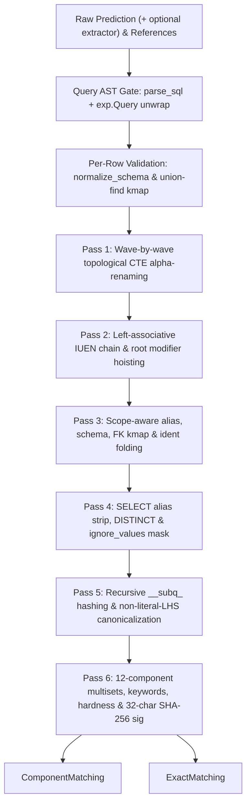

# Adapting Spider to `sqlglot` (`matching.py`)

Both [`ComponentMatching`](component-matching.md) and [`ExactMatching`](exact-matching.md) adapt Yu et al. (EMNLP 2018) onto a **single, dialect-general, bug-fixed `sqlglot` AST engine** in [`src/group_by_vibes/matching.py`](https://github.com/felipepenha/group-by-vibes/blob/main/src/group_by_vibes/matching.py) rather than wrapping or cloning [`taoyds/spider`](https://github.com/taoyds/spider).

This page explains **why** the original parser and dict schema could not generalize, walks through every pass of our **6-pass `sqlglot` decomposition pipeline**, and catalogs all **upstream bugs fixed** and **generalizations added**.

---

## 1. Why Not `process_sql.py` or Flat-Dict Lowering?

During design, we measured two naive ways to bring Spider metrics into `group-by-vibes` against the `500` SQLite gold queries in `bird_mini_dev` ([design doc](https://github.com/felipepenha/group-by-vibes/blob/main/docs/designs/component_and_exact_matching.md)):

| Approach | Outcome on `bird_mini_dev` (`n = 500`) | Why It Was Rejected |
| :--- | :--- | :--- |
| **Verbatim or pure-Python port of `taoyds/spider/process_sql.py`** | Fails on **`>90%`** of gold queries | Pulls `nltk.word_tokenize` + runtime `punkt` downloads; SQLite-centric grammar rejects `INNER`/`LEFT JOIN`, implicit table aliases, `SELECT ... AS` aliases, `IS NULL`, `<>`, and quoted identifiers. |
| **Parse with `sqlglot`, then lower into Spider's flat `dict` AST** | Fails on **`376/500` (`75.2%`)** of gold queries | Spider's flat dict schema has no slots for scalar/cast functions (`CAST`, `ROUND`, `IF`/`IIF`, `SUBSTR`, `COALESCE`: `324/500`), CTEs (`WITH`: `150/500`), `CASE WHEN` (`111/500`), nested/literal arithmetic like `1.0 * a / b` (`111/500`), or window functions (`25/500`). |
| **Direct `sqlglot` AST decomposition (`matching.py`)** | Parses & decomposes **`500/500` (`100.0%`)** of gold queries | Zero new runtime dependencies beyond `sqlglot>=30.0.0,<31.0.0`, full dialect generalization across PostgreSQL/SQLite/MySQL/Snowflake/BigQuery, and full BIRD coverage (`498` `Select`, `2` `Union`). |

---

## 2. Six-Pass `sqlglot` AST Pipeline

Every parsed query runs through `_decompose_query_ast` on a deep AST copy (caller ASTs are never mutated), catching `(SqlglotError, RecursionError)` so deeply nested or malformed trees never crash a batch:

### Query AST Gate (`parse_query_ast`)

1. Calls optional `extractor` (`apply_extractor`) on **predictions only** (references are raw SQL).
2. Calls `parser.parse_sql` to enforce `max_query_chars`, reject empty inputs, reject multi-statement strings, and reject `exp.Command` parser fallbacks.
3. Unwraps outer parenthesized `exp.Subquery` wrappers (hoisting outer `WITH`, `ORDER BY`, `LIMIT`, `OFFSET` onto the wrapped query) and accepts **only `exp.Select` or `exp.SetOperation`** roots—rejecting DDL/DML (`CREATE`, `DROP`, `INSERT`, `UPDATE`, `DELETE`) cleanly as `"non_query"`.

### Pass 1: Wave-by-Wave Topological CTE Alpha-Renaming (`_process_with_clause`)

Equivalently structured queries often name helper CTEs differently (`WITH cte1 AS (...)` vs. `WITH filtered AS (...)`). Pass 1 canonicalizes CTE names deterministically:

1. Extracts every `exp.CTE` in `exp.With`, capturing optional explicit column alias lists (`WITH c(x, y) AS (...)`) and table dependencies.
2. Groups CTEs into **Kahn topological waves** (wave `0` = CTEs referencing no other local CTE; wave `w` = CTEs whose CTE dependencies belong to waves `< w`), temporarily binding recursive self-references to `"__self__"` (and mutual cycles to `"__cycle__"` if encountered).
3. Recursively decomposes each CTE body inside the current wave, sorts wave entries by `(body_nq.canonical_signature, col_aliases)`, assigns consecutive placeholders `__cte_0__`, `__cte_1__`, ..., and propagates `active_cte_map` and `active_cte_cols` into downstream waves and the outer query.

### Pass 2: Left-Associative `IUEN` Flattening

`UNION`, `INTERSECT`, and `EXCEPT` chains are walked left-associatively (`while isinstance(cur, exp.SetOperation)`):

* Matches Spider's convention (`evaluation.py:235-242`): the leftmost base `exp.Select` provides the primary `select`, `from`, `where`, `group`, `order`, etc., while each right-hand branch is recursively decomposed into `(op_kind, NormalizedQuery)` entries in `iuen_branches` (`union`/`intersect`/`except`, or `*_all` when `ignore_distinct=False`).
* Any `WITH`, `ORDER BY`, `LIMIT`, or `OFFSET` attached at outer `SetOperation` nodes is hoisted onto the base query.

### Pass 3: Two-Layer Identifier Normalization, Scope Resolution, `schema`, and `foreign_keys`

Instead of invoking `sqlglot.optimizer.qualify` (which performs invasive projection expansion, subquery unnesting, and schema-dependent rewrites that break structural comparability with Spider), Pass 3 separates identifier handling into two explicit layers:

#### Layer A — Lookup Layer (for `schema` and `foreign_keys` resolution)

* **Why two layers?** Dialects disagree on unquoted casing rules: SQLite folds case-insensitively, Snowflake uppercases unquoted identifiers, PostgreSQL lowercases unquoted identifiers, and BigQuery (`CASE_INSENSITIVE_EXCEPT_TABLES`) keeps table lookup case-sensitive while treating column names case-insensitively.
* Every SQL table, alias, column, and `foreign_keys` endpoint is normalized for **lookup** via `dialects.normalize_grounding_identifier(..., dialect=dialect, is_table=...)` and `dialects.split_qualified_table_parts` (which handles quoted names containing dots or spaces such as `"1-29135051-2"` or `` `Avg. Score` ``), while `schema` catalog tables and columns normalize via `grounding.normalize_schema` (`_normalize_schema_key_part` and `_normalize_schema_column`, preserving exact catalog casing on `postgres` and `snowflake` while folding case-insensitively on `sqlite`).

#### Union-Find Foreign Key Equivalence (`kmap`)

* Validated eagerly per row by `normalize_foreign_keys` (`None` or `[]` allowed; rejects 1-part/3-part names with `ValueError`; rejects `str`/`bytes`/`Mapping` outer values with `TypeError`).
* Pairs such as `[("users.id", "orders.user_id"), ("orders.user_id", "items.uid")]` are grouped via **union-find** so every column in the transitive equivalence class maps to the **lexicographically smallest canonical AST representative** (`canon_by_key` ordered by `(table_name, table_quoted), (col_name, col_quoted)`).
* **Scoping invariant:** Matching Spider's `build_valid_col_units` rule, `kmap` rewrites a resolved `table.col` reference **only when that physical table is active in the current or outer correlated query's `FROM`/`JOIN` sources**.
* Both `schema` and `foreign_keys` perform eager per-row validation with **zero cross-row caching** for deterministic isolation.

#### Alias, Self-Join, Derived Table & `SELECT`-Alias Protection Rules

* **Physical aliases:** `FROM users AS u` rewrites `u.name` -> `users.name`. Self-joins (`FROM emp e1 JOIN emp e2`) map both aliases to physical table `"emp"`, keeping `from_tables = ("emp", "emp")`!
* **Derived tables (`FROM (SELECT ...) AS sub`):** Decomposed eagerly, sorted by `(canonical_signature, src_idx)`, and bound to deterministic placeholders `__subq_0__`, `__subq_1__`, ...
* **`SELECT` output aliases in clauses:** Before qualifying unqualified columns inside `GROUP BY`, `HAVING`, or `ORDER BY`, `matching.py` checks `_select_alias_names` (via `grounding._in_clause_for_select`) so projection aliases (e.g., `SELECT COUNT(*) AS cnt FROM users ORDER BY cnt`) are never mis-qualified as `users.cnt`.
* **Unqualified column qualification:** If `schema` is provided, qualifies an unqualified column only when **exactly one** active physical table in scope owns that column; if `schema is None`, qualifies only when the query has a **single non-opaque physical table and no CTE/derived sources**. Ambiguous columns stay unqualified safely.

#### Layer B — Canonical AST Layer (for rendered expressions)

After all alias/schema/`kmap` lookups finish, `_fold_ident_inplace` folds **all unquoted `exp.Identifier` nodes to lowercase** while preserving exact text on **quoted identifiers** (`ident.quoted == True`) across every dialect. That ensures Snowflake unquoted `SELECT COUNT(*) FROM USERS` and lowercase `SELECT count(*) FROM users` fold identically, while `"MixedCase"` vs `"mixedcase"` stays distinct when quoted.

### Pass 4: Alias Stripping, `DISTINCT`, and Value-Blind Masking

1. **Strip `SELECT` output aliases:** `SELECT expr AS alias` -> `expr` (now safe because Pass 3 already protected `GROUP BY`/`HAVING`/`ORDER BY` alias references).
2. **`ignore_distinct=True` (default):** Clears `SELECT DISTINCT` / `DISTINCT ON` and unwraps `DISTINCT` inside aggregate functions (`COUNT(DISTINCT id)` -> `COUNT(id)`). Set `ignore_distinct=False` to enforce exact `DISTINCT` parity.
3. **`ignore_values=True` (default):**
   * Rewrites `COUNT(1)` -> `COUNT(*)` first (before masking `1`!).
   * Replaces non-exempt `exp.Neg(Literal)` and `Literal` / `Boolean` / `Null` nodes with `exp.Var(this="__val__")`.
   * **Explicit AST Exemptions (`_is_exempt_from_value_mask`):** Never masks literals inside `exp.DataTypeParam`/`exp.DataType` (`CAST(x AS VARCHAR(10))`), `exp.Limit`/`exp.Fetch`/`exp.Offset` (controlled separately by `include_limit_value`), `exp.WindowSpec` frame bounds (`ROWS BETWEEN 1 PRECEDING AND CURRENT ROW`), or positional integer ordinals directly in `GROUP BY 1` / `ORDER BY 1`.

### Pass 5: Recursive Subquery Hashing & Non-Literal-LHS Canonicalization

1. **Nested subquery placeholders (`_replace_nested_subqueries_in_subtree`):** Any nested `exp.Select`, `exp.SetOperation`, or `exp.Subquery` inside `WHERE`, `HAVING`, `SELECT`, or `JOIN ON` (preserving outer correlated scopes `outer_aliases`/`outer_qual`/`outer_physical`) is recursively decomposed into a `NormalizedQuery` and replaced with `exp.Var(this=f"__subq_{sub_nq.canonical_signature}__")`. Because `canonical_signature` is a 32-char SHA-256 hash of order-normalized sub-components, reordered clauses *inside* nested subqueries still match identically.
2. **Non-literal-LHS predicate canonicalization (`_canonicalize_predicates_subtree`):**
   * Note that both `!=` and `<>` parse to `exp.NEQ` in `sqlglot`.
   * `_is_rhs_value_like` classifies `Literal`, `Boolean`, `Null`, `Placeholder`, `Neg(Literal)`, `__val__`, and `__subq_*__` (important because `__subq_` starts with `_`, ASCII 95 < `'a'`, so subquery RHS stays on `expression` matching `WHERE col = (SELECT ...)`).
   * For `EQ`/`NEQ`: always places the non-value expression on `this` (LHS) and value-like operand on `expression` (RHS)—so `'S' = s.rtype` becomes `s.rtype = 'S'` (or `s.rtype = __val__`). Equal-class operands sort lexicographically by rendered SQL (`a = b` vs `b = a`).
   * For ordered comparisons (`<`, `<=`, `>`, `>=`): flips operator and operands when LHS is value-like and RHS is not (`10 < age` -> `age > 10`).
   * Sorts literal lists inside `IN (...)` when no subquery is attached, and flattens/sorts associative `AND`/`OR` chains while keeping precedence parentheses on mixed operators (`(a OR b) AND c`).

### Pass 6: Extraction, `canonical_signature`, and Hardness

* Extracts all 12 immutable clause representations into `NormalizedQuery`.
* **Dialect AST edge cases handled explicitly:** In PostgreSQL, `NOT LIKE` and `IS NOT NULL` attach `negate=True` on `exp.Like`/`exp.Is` instead of wrapping in `exp.Not`; `_extract_condition_keywords_and_counts` checks both `isinstance(node, exp.Not)` and `bool(node.args.get("negate"))` so `keywords` always records `"not"`. Similarly, omitted `ORDER BY` direction defaults to `"asc"` and emits `"asc"` in `keywords`.
* Computes the 32-char SHA-256 `canonical_signature` over JSON-sorted component bags (retaining order on `order_by`) and computes the 4-level Spider hardness bucket (`easy`, `medium`, `hard`, `extra`).

---

## 3. Complete Summary: Upstream Bugs Fixed & Generalizations

### Verified Defects Fixed vs. `taoyds/spider/evaluation.py`

| Upstream Location | Upstream Defect | Impact | Fix in `group_by_vibes` |
| :--- | :--- | :--- | :--- |
| `evaluation.py:604-605` | Sets `f1 = 1` whenever `acc == 0` and `rec == 0` regardless of `acc_count`/`rec_count`. | Components with `0%` matches (`IUEN`, `cte` on BIRD) falsely score **`1.000`**! | [`finalize_component_bucket`](https://github.com/felipepenha/group-by-vibes/blob/main/src/group_by_vibes/matching.py#L1987-L2011) returns `None` only when `pred_count == 0 and label_count == 0`, else `0.0`. |
| `evaluation.py:195-203, 419` | `eval_and_or` returns `(len(pred), len(label), 0)` on mismatch while caller unpacks `(label_total, pred_total, cnt)`; returns `(1, 1, 1)` on empty `set()`. | Swaps precision/recall denominators on mismatch and inflates `and/or` F1 with empty queries. | [`score_pair`](https://github.com/felipepenha/group-by-vibes/blob/main/src/group_by_vibes/matching.py#L1870-L1877) fixes tuple order and excludes both-empty `and/or` sets from corpus denominators (`pred_total=label_total=0`, per-example `1`). |
| `evaluation.py:333, 338` | `count_others` calls `count_agg(unit[0] != 0)` on `where[::2]` (`not_op` booleans) and unsliced `having` (`'and'`/`'or'` strings). | Falsely inflates `agg_count > 1` hardness checks. | [`_count_current_level_aggs`](https://github.com/felipepenha/group-by-vibes/blob/main/src/group_by_vibes/matching.py#L1085-L1101) counts only genuine `exp.AggFunc` AST nodes at current query level. |
| `evaluation.py:386-390` | `sorted(label['from']['table_units'])` crashes with `TypeError` on `>= 2` subquery dicts; skips `FROM` check when `len(label) == 0`. | Python 3 crash on multiple derived tables; false positive when gold has no `FROM`. | Unconditionally checks `Counter(from_tables)` equality and recursive order-insensitive multiset matching on `from_subqueries`. |
| `evaluation.py:123` | `eval_sel` mutates `label['select'][1]` in place via `.remove()`. | Corrupts reused gold dicts on repeated or multi-reference evaluation. | Immutable `NormalizedQuery` tuples/frozensets and pure `Counter` set intersections. |

### Generalizations Beyond `taoyds/spider`

| Area | `taoyds/spider` Limitation | Generalization in `group-by-vibes` |
| :--- | :--- | :--- |
| **SQL Dialects & Grammar** | SQLite-centric parser + `nltk`; fails `>90%` of BIRD SQL | Any `sqlglot` dialect (`postgres`, `sqlite`, `mysql`, `snowflake`, `bigquery`, etc.); `100%` of `bird_mini_dev` gold (`500/500`) |
| **Evaluated Components** | `10` keys (`5` headline in Paper Table 3) | `12` keys: adds `cte` (`WITH`) and opt-in `join_on` (`include_join_conditions=True`) |
| **Value / Strict Toggles** | Hardcoded `DISABLE_VALUE = True`, `DISABLE_DISTINCT = True` | Same defaults for Spider parity + 5 explicit auditable toggles (`ignore_values`, `ignore_distinct`, `include_limit_value`, `include_join_conditions`, `skip_unparseable_predictions`) |
| **HAVING & LIMIT Edges** | Requires `GROUP BY` for `group`; requires `ORDER BY` for `order`; order-sensitive `having` lists | Supports standalone `HAVING`, order-insensitive `GROUP BY`/`HAVING` multisets, `LIMIT`/`OFFSET` without `ORDER BY`, `FETCH`, and `NULLS FIRST/LAST` |
| **Schema & Foreign Keys** | Requires Spider `tables.json` global DB files | Optional per-query `schema` dict + transitive union-find `foreign_keys` (`kmap`) with zero global state and AST-only fallback when omitted |
| **Safety & Privacy** | Prints/stores raw SQL dicts in memory | Bounded `max_input_chars` / `max_query_chars`, `(SqlglotError, RecursionError)` guards, and zero raw SQL or literals in `per_example` outputs or logs |
